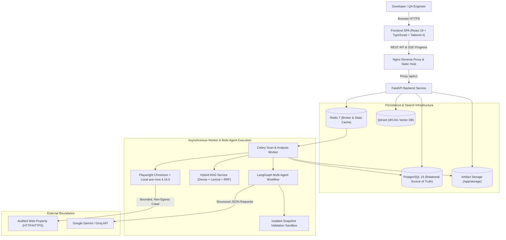

# AccessGuard AI

> Enterprise-grade accessibility observability platform combining automated Playwright + axe-core auditing, hybrid WCAG retrieval-augmented generation (RAG), and human-approved remediation workflows with isolated snapshot validation.

[](https://github.com/Saksham2005-coder/AccessGuard-AI/actions/workflows/ci.yml)
[](LICENSE)
[](https://python.org)
[](https://react.dev)
[](https://github.com/dequelabs/axe-core)

---

## Overview

AccessGuard AI is a developer-focused accessibility observability and remediation platform. It provides continuous auditing of web applications against WCAG 2.2 standards, hybrid dense-lexical retrieval of authoritative W3C guidance, and multi-agent remediation proposals validated inside isolated DOM environments.



---

## Core Principles & Security Guarantees

Unlike generic AI wrappers, AccessGuard AI enforces strict technical and ethical boundaries:

1. **Zero Hallucinated Citations:** All regulatory references and remediation guidance originate strictly from indexed official W3C recommendations (WCAG 2.2, Understanding WCAG 2.2, Techniques, ARIA APG) via hybrid dense-lexical retrieval.
2. **Strict Human-in-the-Loop:** Automated fixes are never applied directly to production environments. Remediations are structured proposals requiring explicit review, tenant authorization, and approval.
3. **Isolated Snapshot Validation:** Approved fixes are validated inside isolated sandboxed DOM environments using local `axe-core` before engineers incorporate them into source code. Outbound network requests are intercepted and aborted (`page.route("**/*", abort)`).
4. **SSRF and Abuse Protections:** DNS ownership verification, strict private IP blocklists (blocking loopback, RFC 1918, and cloud IMDS `169.254.169.254`), redirect re-validation, and browser sandbox isolation prevent misuse.
5. **No False Claims:** AccessGuard AI never makes deceptive claims such as "100% WCAG Compliant" or "Certified Accessible". Automated scanning covers significant, objective criteria, while human evaluation remains essential for complete accessibility.

---

## Technology Stack

- **Backend:** FastAPI, Python 3.12, Pydantic v2, SQLAlchemy 2.0 (async), Alembic, Celery
- **Database & State:** PostgreSQL 16 (relational source of truth), Redis 7 (broker & caching)
- **Vector Search:** Qdrant (cosine distance vector indexing)
- **Scanner Engine:** Playwright Python (Chromium headless) with locally pinned `axe-core@4.14.0`
- **Retrieval & RAG:** Local `sentence-transformers/all-MiniLM-L6-v2` embeddings, PostgreSQL Full-Text Search (lexical), Reciprocal Rank Fusion (RRF, $k=60$)
- **Multi-Agent Orchestration:** LangGraph stateful multi-agent workflow with human-in-the-loop checkpointing
- **LLM Support:** Google Gemini (`gemini-2.5-flash`), Groq (`llama-3.3-70b-versatile`), deterministic Mock provider for offline CI
- **Frontend:** React 19, TypeScript, Vite, Tailwind CSS 4, TanStack Query, React Router v7, Lucide Icons, Recharts
- **Infrastructure & Deployment:** Multi-stage Dockerfiles, Docker Compose, Nginx 1.27, GitHub Actions

---

## Monorepo Layout

```text
AccessGuard-AI/
├── backend/            # FastAPI backend, domain services, workers, scanner & RAG
│   ├── app/            # Application modules (api, core, models, rag, scanner, ai, worker)
│   ├── scripts/        # Ingestion, evaluation, and database seeding scripts
│   └── tests/          # Comprehensive pytest test suite (unit, integration, e2e, security)
├── frontend/           # React 19 + TypeScript + Tailwind CSS 4 web dashboard
│   ├── src/            # Components, pages, hooks, services, and design tokens
│   └── nginx.conf      # Hardened Nginx configuration for production container
├── tools/axe/          # Local, version-pinned axe-core 4.14.0 bundle
├── knowledge_base/     # Official W3C WCAG 2.2 sources and evaluation datasets
├── test_sites/         # Local deterministic test fixture websites for offline audits
├── infrastructure/     # Dockerfiles, deployment guides, and stack initialization scripts
├── docs/               # System architecture, operations runbook, threat model, evaluation
└── .github/workflows/  # CI/CD pipelines (unit, lint, e2e, docker build)
```

---

## Quickstart

### Option A: Complete Docker Compose Stack (Recommended)

To start the entire containerized stack (PostgreSQL, Redis, Qdrant, Backend API, Celery Worker, and Frontend UI):

```bash
# 1. Clone repository
git clone https://github.com/Saksham2005-coder/AccessGuard-AI.git
cd AccessGuard-AI

# 2. Configure environment
cp .env.example .env
# Edit .env to set your GEMINI_API_KEY or GROQ_API_KEY (or use LLM_PROVIDER=mock)

# 3. Initialize and boot the stack
bash infrastructure/scripts/init-stack.sh
```

Once running, navigate to:
- **Frontend Dashboard:** [http://localhost](http://localhost) (or port configured in `.env`)
- **Backend API & Swagger Docs:** [http://localhost:8000/docs](http://localhost:8000/docs)
- **Readiness Health Check:** [http://localhost:8000/health/ready](http://localhost:8000/health/ready)

### Option B: Local Development Setup

#### 1. Start Supporting Services
```bash
docker compose up -d postgres redis qdrant
```

#### 2. Backend Setup
```bash
cd backend

# Install dependencies with uv
uv sync --all-groups
uv run playwright install chromium

# Apply database migrations
uv run alembic upgrade head

# Ingest official W3C WCAG knowledge base
uv run python scripts/ingest_sources.py

# Start FastAPI dev server
uv run uvicorn app.main:app --reload --host 127.0.0.1 --port 8000
```

In a separate terminal, start the Celery background scan worker:
```bash
cd backend
uv run celery -A app.worker.celery_app worker --loglevel=INFO --concurrency=2
```

#### 3. Frontend Setup
```bash
cd frontend
npm install
npm run dev
```

The frontend development server will start at [http://localhost:5173](http://localhost:5173).

---

## Running Verification & Test Suites

### Backend Unit, Integration, E2E & Security Tests
```bash
cd backend
uv run pytest tests/ -v
uv run ruff check .
uv run ruff format --check .
```

### Frontend Tests, Linter & Production Build
```bash
cd frontend
npm run lint
npm run test -- --run
npm run build
```

### RAG Retrieval & Benchmark Evaluation
```bash
cd backend
uv run python scripts/evaluate_rag.py \
  --dataset ../knowledge_base/evaluation/retrieval_cases.jsonl \
  --report-json ../docs/retrieval_benchmark.json \
  --k 5
```

---

## Detailed Documentation

- [System Architecture](docs/ARCHITECTURE.md) — Comprehensive component topology, LangGraph DAG, and snapshot sandbox design
- [Operations Runbook](docs/OPERATIONS.md) — Production operations, Celery management, migrations, backups, and disaster recovery
- [Evaluation & Benchmark Report](docs/EVALUATION.md) — Empirical accuracy and latency benchmarks for RAG retrieval and agent proposals
- [Deployment & Hardening Guide](infrastructure/deployment/DEPLOYMENT_GUIDE.md) — Production deployment guidelines, security boundaries, and container profiles
- [Scanner Threat Model](docs/SCANNER_NETWORK_THREAT_MODEL.md) — SSRF defense-in-depth, DNS validation, and network isolation

---

## License

AccessGuard AI is open-source under the [MIT License](LICENSE).