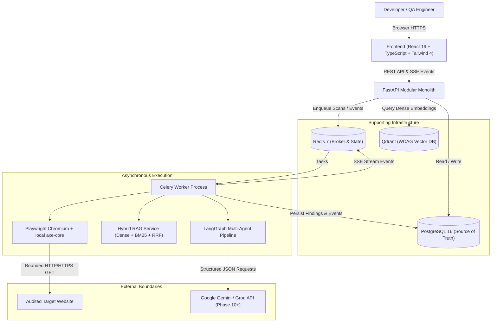

# AccessGuard AI — System Architecture

## 1. System Overview

AccessGuard AI is an automated accessibility observability platform that combines deterministic browser-based WCAG scanning with an evidence-grounded hybrid retrieval system (RAG) and human-approved remediation workflows.

## 2. Component Boundaries and Responsibilities

### 2.1 Frontend (`frontend/`)
- Single-page application built with React 19, TypeScript, and Tailwind CSS 4.
- Managed server state with TanStack Query; real-time event streaming via Server-Sent Events (SSE).
- Presents real metrics, immutable scan audit snapshots, findings explorer, and remediation proposals.
- No direct external network calls or LLM API keys in the browser bundle.

### 2.2 FastAPI Backend (`backend/app/api/`)
- Unified versioned REST API (`/api/v1/`).
- Centralized authentication via JWT access tokens and secure Argon2 password hashing.
- Domain authorization: all resource queries strictly enforce `owner_id = current_user.id`.
- Request context middleware attaching unique Request IDs and structured JSON logging.
- Health checks: `/health/live` (process liveness) and `/health/ready` (dependency readiness).

### 2.3 Scanner Engine (`backend/app/scanner/`)
- Playwright Chromium in headless mode within sandboxed browser contexts.
- Local injection of pinned `axe-core` bundle from `tools/axe/node_modules/axe-core/axe.min.js`.
- Target safety: URL normalization, strict SSRF validation (private/loopback/cloud metadata IP blocking), redirect destination validation, and DNS ownership checks.
- Bounded BFS link discovery with strict depth, page, and timeout limits.
- Finding normalization, stable fingerprint generation, and deduplication.

### 2.4 Hybrid RAG Service (`backend/app/rag/`)
- Authoritative corpus parsed from official W3C recommendations (WCAG 2.2, Understanding WCAG 2.2, Techniques, ARIA APG).
- Dense retrieval: local `sentence-transformers/all-MiniLM-L6-v2` embeddings stored in Qdrant with cosine similarity.
- Lexical retrieval: PostgreSQL Full-Text Search for exact criterion numbers (`1.4.3`), ARIA role names, and axe rule IDs.
- Reciprocal Rank Fusion (RRF) merging dense and lexical candidate lists deterministically.
- Strict citation validator verifying that every referenced citation exists in PostgreSQL before presentation.

### 2.5 Multi-Agent Orchestration (`backend/app/agents/`)
- Stateful directed graph managed by LangGraph.
- Specialized nodes: Scan Context -> RAG Retrieval -> Finding Analysis -> Remediation Proposal -> Review Node -> Approval Interrupt -> Snapshot Validation -> Finalize.
- Human-in-the-loop: Execution pauses at the approval interrupt node until the project owner explicitly approves or rejects the proposed patch.
- Deterministic mock provider enabled for Phases 1–9 and isolated testing.

### 2.6 Remediation & Sandboxed Validation (`backend/app/remediation/`)
- Allowed patch formats: `snippet`, `dom_operations`, `manual_steps`.
- Strict patch policy: allows only safe DOM mutations (`set_attribute`, `remove_attribute`, `replace_text`) against explicit selectors.
- Reconstructs isolated DOM snapshots without remote scripts, styles, or media.
- Re-executes axe-core locally to verify that the targeted violation is eliminated without introducing new violations.

---

## 3. Storage Architecture

| Store | Purpose | Data Contained |
|---|---|---|
| **PostgreSQL 16** | Relational Source of Truth | Users, projects, domain verifications, scans, scan pages, findings, finding nodes, knowledge sources, knowledge chunks, remediations, approvals, validation results, scan events, reports. |
| **Redis 7** | Cache & Job Broker | Celery task queues, scan progress pub/sub, SSE cursors. |
| **Qdrant** | Vector Search Engine | 384-dimensional dense vectors for indexed WCAG knowledge chunks. |
| **Filesystem / Volume** | Artifact Storage | DOM snapshots, screenshots, generated PDF/JSON reports (`/app/storage`). |

---

## 4. Threat Model & Security Posture

1. **SSRF Defense:** Full pre-navigation IP resolution checking all DNS answers against RFC1918, RFC3927 (link-local), loopback, IPv6 mapped IPv4, and cloud metadata (169.254.169.254). Redirect destinations are re-validated before following.
2. **Tenant Isolation:** Multi-tenant isolation enforced at the database query level on every endpoint. No horizontal privilege escalation (IDOR).
3. **Browser Sandboxing:** Playwright runs with restricted permissions, disabling downloads, popups, and non-HTTP protocols.
4. **Prompt Injection Mitigation:** All scanned page snippets, HTML snippets, and retrieved excerpts are treated strictly as data, never system instructions. Tools have bounded typed inputs.
5. **No Blind Production Changes:** The system never mutates live websites or integrates write access to external CMS platforms.
