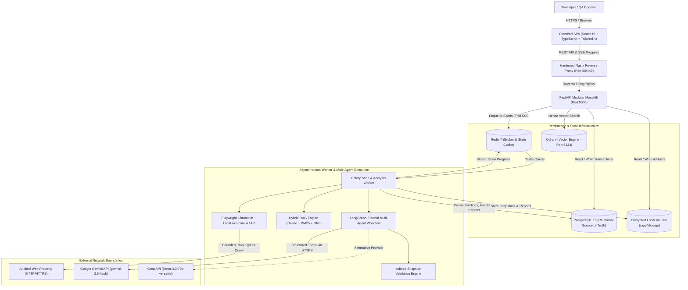
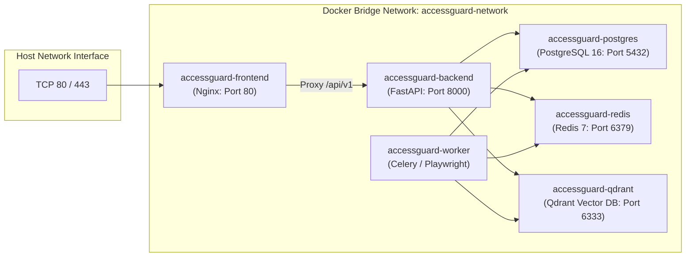

# AccessGuard AI — System Architecture

## 1. System Overview

AccessGuard AI is an automated, enterprise-grade accessibility observability and remediation platform. It combines deterministic, browser-based WCAG scanning with an evidence-grounded hybrid retrieval system (RAG) and human-approved remediation workflows validated within isolated, sandboxed DOM snapshots.



---

## 2. Component Boundaries and Responsibilities

### 2.1 Frontend Single Page Application (`frontend/`)
- **Technology**: React 19, TypeScript, Vite, Tailwind CSS 4.
- **State Management**: TanStack Query (React Query) for server caching, native React Context for authentication and project scope.
- **Real-Time Streaming**: Native Server-Sent Events (`EventSource`) consumer for live scan progress stages (Discovered, Audited, Completed, Failed).
- **Security Boundary**: Zero client-side storage of LLM provider keys or backend database credentials; all requests are authenticated via short-lived JWT access tokens with automatic refresh token rotation.
- **Audit Presentation**: Findings explorer with interactive filtering, WCAG criterion drawer, side-by-side DOM remediation preview, and executive report viewer.

### 2.2 FastAPI Application Service (`backend/app/api/`)
- **Framework**: FastAPI with asynchronous endpoints and Pydantic v2 data validation schemas.
- **Tenant Isolation**: Every database access strictly enforces `project.owner_id == current_user.id`. Resource cross-talk and Insecure Direct Object References (IDOR) are barred at the data layer.
- **Observability**: Request ID correlation middleware injects `X-Request-ID` into every HTTP header and structured JSON log entry.
- **Health Probes**:
  - `/health/live`: Fast process liveness verification.
  - `/health/ready`: Deep dependency checks (PostgreSQL connectivity, Redis ping, Qdrant vector collection status, local axe-core bundle existence).

### 2.3 Scanner Engine & SSRF Egress Defense (`backend/app/scanner/`)
- **Sandboxed Browser**: Playwright Chromium launched with `--disable-gpu`, `--no-sandbox`, `--disable-dev-shm-usage`, and non-root execution.
- **Deterministic Auditing**: Injects a pinned, offline copy of `axe-core@4.14.0` from `tools/axe/node_modules/axe-core/axe.min.js` (or via `AXE_BUNDLE_PATH`).
- **Target Policy & SSRF Guard**:
  - Resolves target hostnames via system DNS before browser dispatch.
  - Blocks all IPv4/IPv6 loopback (`127.0.0.0/8`, `::1`), RFC 1918 private subnets (`10.0.0.0/8`, `172.16.0.0/12`, `192.168.0.0/16`), link-local addresses (`169.254.0.0/16`), carrier-grade NAT, and cloud metadata endpoints (`169.254.169.254`).
  - Validates all HTTP redirect hops through the same policy before navigation continues.
- **Crawler Controls**: Enforces strict maximum pages (default 20), maximum crawl depth (default 3), crawl rate limiting, and per-page execution timeouts.

### 2.4 Hybrid RAG Knowledge Engine (`backend/app/rag/`)
- **Authoritative Corpus**: Official W3C WCAG 2.2 Recommendation, Understanding WCAG 2.2, Techniques for WCAG 2.2, and WAI-ARIA Authoring Practices Guide (APG).
- **Dual-Path Retrieval**:
  1. *Dense Vector Search*: 384-dimensional dense vectors generated via `sentence-transformers/all-MiniLM-L6-v2`, indexed in Qdrant with cosine similarity.
  2. *Lexical Keyword Search*: PostgreSQL Full-Text Search / BM25 tokenized search with boosting for exact criterion IDs (`1.4.3`, `2.4.7`) and ARIA roles.
- **Reciprocal Rank Fusion (RRF)**: Merges candidates from both paths using $RRF(d) = \sum \frac{1}{k + r(d)}$ ($k = 60$).
- **Deterministic Citation Verification**: `CitationValidator` cross-references every cited source against persisted database records, rejecting hallucinations before LLM generation.

---

## 3. LangGraph Remediation & Validation Workflow

The remediation lifecycle uses a stateful directed acyclic graph (DAG) built with LangGraph:

```mermaid
flowchart TD
    Start([Scan Finding Detected]) --> ExtractContext[Node: Extract Finding & DOM Context]
    ExtractContext --> RetrieveRAG[Node: Hybrid WCAG Retrieval]
    RetrieveRAG --> ValidateCitations[Node: Verify Authoritative W3C Citations]
    ValidateCitations --> GenerateProposal[Node: Multi-Agent Proposal Generation]
    GenerateProposal --> SafePatchCheck[Node: Safe DOM Patch Policy Validation]
    
    SafePatchCheck --> HumanApproval{Human Approval Interrupt\n(State Checkpointed in DB)}
    
    HumanApproval -->|Rejected / Cancelled| FinalizeRejected[Status: Rejected]
    HumanApproval -->|Approved by Project Owner| IsolatedSnapshot[Node: Reconstruct Sandboxed DOM]
    
    IsolatedSnapshot --> ApplyPatch[Node: Apply Allowlisted Safe DOM Patch]
    ApplyPatch --> LocalAxeAudit[Node: Run axe-core in Headless Chromium\n(Network Abort Enabled)]
    
    LocalAxeAudit --> CheckResults{Target Violation\nEliminated?}
    CheckResults -->|Yes & No New Violations| Validated[Status: Validated\nReady for Code Review]
    CheckResults -->|No or Regression Detected| FlagRegression[Status: Validation Failed\nRegression Warning Attached]
```

### Key Workflow Guarantees:
1. **Human-in-the-Loop Interrupt**: The workflow persists execution state to PostgreSQL and halts. No patch is executed without explicit human consent.
2. **Safe DOM Patch Policy**: Modifications are restricted to safe declarative attributes (`alt`, `aria-*`, `role`, `tabindex`, `title`, and inner text). Executable attributes (`onclick`, `src`, `href="javascript:..."`, `<script>`) are rejected outright.
3. **Isolated Snapshot Environment**: Validations take place in an isolated headless browser context where all outbound network requests (`**/*`) are intercepted and aborted. No external dependencies, styles, or trackers are requested.
4. **Targeted Elimination**: The re-audit certifies that the specific finding fingerprint is eradicated without introducing secondary axe-core violations on the patched element.

---

## 4. Container & Network Topology



- **Non-Root Execution**: Backend and Worker containers execute under dedicated non-root UID `10001:10001` (`accessguard`).
- **Internal Network Isolation**: PostgreSQL, Redis, and Qdrant communicate strictly across the internal `accessguard-network` bridge and do not expose external ports in production mode.
- **Nginx Ingress**: Frontend container acts as the single public entry point, serving static React assets with aggressive cache headers and proxying `/api/v1/` to the FastAPI backend.

---

## 5. Storage & Persistence Architecture

| Datastore | Engine | Storage Target | Description |
|---|---|---|---|
| **Primary Relational** | PostgreSQL 16 | Docker Volume `postgres_data` | Users, sessions, projects, verifications, scans, findings, remediations, approvals, scan events. |
| **Broker & Cache** | Redis 7 | Docker Volume `redis_data` | Celery asynchronous queues, SSE cursors, session locks. |
| **Vector Index** | Qdrant | Docker Volume `qdrant_data` | 384-dimensional dense embeddings for WCAG knowledge base. |
| **Artifact Store** | Encrypted Volume | Local Mount `/app/storage` | DOM snapshots, isolated audit traces, executive PDF/JSON report exports. |

---

## 6. Threat Model & Security Controls

1. **Server-Side Request Forgery (SSRF)**:
   - Comprehensive DNS pre-resolution blocks private IP address spaces and cloud instance metadata services (169.254.169.254).
   - Redirect chain re-evaluation prevents DNS rebinding or hop-away SSRF attacks.
2. **Multi-Tenant Data Isolation**:
   - Every database query filters by `project.owner_id = current_user.id`. Insecure direct object references (IDOR) return HTTP 404/403.
3. **Prompt Injection Hardening**:
   - Scanned web pages, target HTML snippets, and retrieved knowledge text are parsed strictly as untrusted data strings.
   - Structured JSON schema enforcement with Pydantic ensures LLMs cannot hijack agent tool routing.
4. **No Mutation of Live Properties**:
   - AccessGuard AI does not integrate write access to target production websites or CMS platforms. All code remediations are presented as immutable diff proposals for human review.
